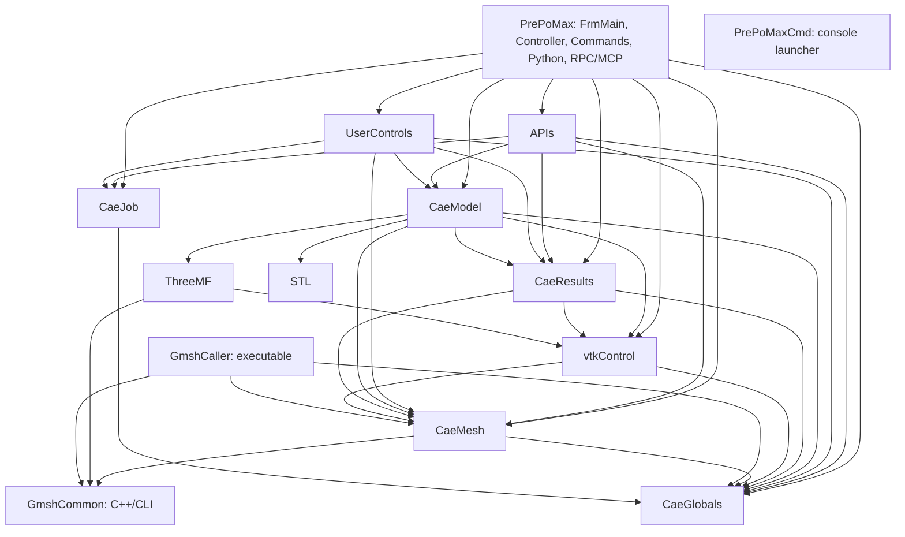

# Existing architecture and reuse assessment

All observations refer to the pinned source baseline in [initial audit](reports/initial-audit.md). Every solution project was inspected. All tracked C#/C++/header/project/target files were scanned; representative boundary implementations were read. This is architectural reconnaissance, not a line-by-line correctness review.

## Project graph

Arrows mean project reference, not runtime data flow. All 13 C# projects target .NET Framework 4.8; the fourteenth project is .NET Framework 4.8 C++/CLI. C# configurations largely target x64, while UserControls has AnyCPU configurations. See project files for exact configurations.

`PrePoMaxCmd` has no project references and launches the Windows application as `PrePoMax.com`; it is not an engineering CLI. `STL` has no project references. ThreeMF's GmshCommon/vtkControl references exist even though the generated `Lib3MF.cs` is primarily a C ABI binding; unused-reference removal needs compilation evidence.

## Runtime flow and source ownership

`PrePoMax/Forms/FrmMain.cs` drives `PrePoMax/Controller.cs`, which holds model/results/jobs/selection state. Commands under `PrePoMax/Commands/` call `Execute(Controller receiver)`; `CommandsCollection` records, regenerates, undoes/redoes and emits Python journals. Some commands implement `ICommandWithDialog`; e.g. `0086_DefinedField/CAddDefinedField.cs` combines model changes with file selection and deep cloning.

| Function | Components and concrete evidence |
|---|---|
| FE representation | `CaeModel/FeModel.cs`; materials, sections, loads, boundary conditions, constraints, interactions, steps in their corresponding directories |
| Mesh/connectivity/selection | `CaeMesh/FeMesh.cs`, `Elements/`, `Parts/VisualizationData.cs`; `CaeGlobals/Selection/`; FEM node/element IDs and geometric entity mapping must stay stable |
| Geometry | `GeometryPart`, BREP metadata and visualization in CaeMesh; CAD operations dispatched by Controller to the custom NetGenMesher executable |
| Meshing | `PrePoMax/Meshing/Base/IMesherRunner.cs`, `MesherRegistry`, Netgen/Mmg/Gmsh/QuadWild runners; `CaeMesh/Meshing/Gmsh/` contains substantive sweep/transfinite/revolve algorithms |
| Solver decks | `CaeModel/FileInOut/Output/Calculix/`, Abaqus output; Controller prepares jobs and file dependencies |
| Solver execution | `CaeJob/AnalysisJob.cs`, `ExecutableJob.cs`; `PrePoMax/Common/ExecutableJobRunner.cs`; process containment in `CaeGlobals/ChildProcessJob.cs` |
| Results | `CaeResults/FeResults.cs`, `HistoryOutputs/`, field outputs, CalculiX `FrdFileReader`, `FrdStreamReader`, `DatFileReader`; OpenFOAM reader and history exports |
| Persistence | Controller `SaveToPmx`, `TryReadCompressedPmx*`; CaeGlobals dump helpers and binder; mesh/results custom binary blocks |
| View | `vtkControl/vtkControl.cs`, `vtkMax/Actor/`, lookup tables, widgets, interactor; UserControls hosts WinForms model trees, plots and editors |
| Scripting/agents | `APIs/Python/`, `PrePoMax/Python/`, `PrePoMax/Rpc/`, `PrePoMax/Mcp/`; APIs use gateways implemented against Controller |

## What can be reused

**Inference, not a completed port:** FEM data, equations/units, connectivity operations, CalculiX deck generation and results calculations have high algorithmic reuse potential. Materials such as `CaeModel/Materials/Elastic.cs` already contain old-format compatibility logic. Rewriting these would lose upstream value and multiply numerical regression risk.

**Verified constraint:** whole engineering assemblies are not clean portable libraries. CaeGlobals includes WinForms editors, hooks, message boxes, registry/WMI and serialization. CaeMesh directly references GmshCommon and calls WinForms `Application.DoEvents()` in `Meshing/Gmsh/GmshAPI.cs`; `FeMesh` can show warnings. CaeModel's ThreeMF writer consumes `vtkMaxActorData`/`vtkMaxLookupTable`. CaeResults references vtkControl, but some `using vtkControl` imports appear unused; distinguish them from actual API coupling before splitting results code. VTK-named cell enums and connectivity arrays are not themselves native VTK calls.

**Controller:** substantial application behavior is reusable, but `Controller` has an explicit `FrmMain _form` and pervasive direct `_form` calls for state, tree changes, dialogs, drawing and persistence UI state. It cannot currently run as a standalone controller library. Preserve method bodies, introduce narrow services in future approved work, and avoid a blanket MVVM rewrite. Commands are useful upstream-aligned units but inherit the controller, dialogs and BinaryFormatter deep-clone constraints.

**Existing seams:** `APIs/Python/Commands/IPython*Gateway.cs` covers command/model/mesh/job/selection/view operations; implementations under `PrePoMax/Python/Commands/` forward to Controller. Reuse these as behavior contracts and test surfaces. They do not remove Controller's dependencies. `IMesherRunner`/`ExecutableJobRunner` give an existing process boundary to extend rather than replace.

## GUI and concurrency

WinForms forms/dialogs and custom controls live in PrePoMax and UserControls; property editors leak into CaeGlobals. Settings live in `PrePoMax/Settings/`, with binary settings files by `Application.StartupPath`. Rendering is embedded as a WinForms user control with native window handles. The Python engine uses pythonnet 3.1.0 and a CPython 3.12 DLL loaded relative to startup; GIL management and thread lifetime are explicit.

`RpcUiThread` marshals calls with `FrmMain.BeginInvoke`, and current picking reads VTK state on the rendering/UI thread (commit `0648a3c0`). Batch `-g No` still instantiates `FrmMain`, positions it offscreen and runs `Application.Run` (`Program.cs:163–177`). Preserve serialized mutation, busy/prompt refusal, cancellation and UI-thread pick semantics in a new host; “headless” currently means unattended Windows UI.

## Python and MCP execution

`PythonEngineManager.SetPrePoMaxAPI` supplies the `pmx` object to a persistent Python scope; APIs construct their model/job/mesh/view/selection services with Controller-backed gateways. CLI script execution, interactive console, recorded-script commands and Python journal emission all share this behavior. CPython is embedded with pythonnet, not an external Python process issuing a new independent FEM implementation. Reuse service/API contracts, enum vocabulary, unit semantics and errors.

`PrePoMax/Mcp/McpHttpServer.cs` serves loopback `/mcp`, normally port 8756 with a bounded next-free-port probe. Tools include `get_guide`, `get_status`, `describe_api`, `read_model`, `read_topology`, `run_python`, `eval_expression`, `get_call`, `cancel_call`, history, screenshots, jobs and session inspection. The MCP protocol server advertises versions 2024-11-05/2025-03-26/2025-06-18; the named-pipe/session-discovery protocol is separately versioned 1.0. Large operations return running/callId for collection rather than requiring a repeated mutation.

The automation server needs a folder-specific generated bearer token, rejects Origin headers, and supports read-only/busy/prompt refusal. Settings/first-run logic clears redistributed tokens; session files and named pipes are restricted using Windows ACLs. Preserve these behaviors with platform-appropriate private storage and transport permissions. No session token was read or recorded by this audit.

Most script/API work executes on connection/thread-pool workers, with FrmMain methods marshaling their own UI updates; `RpcUiThread` explicitly warns that routing all work to the UI thread can deadlock long/asynchronous operations. Rendering/picking and idle checks are the special UI-thread cases. A future dispatcher must preserve this distinction, not blanket-dispatch every API call onto the render thread.
