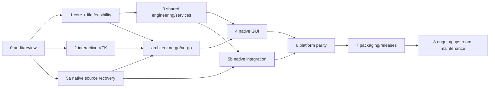

# Dependency-aware roadmap

Task 0002, the first bounded increment of Phase 1, is now authorized and implemented locally. Its Mac ARM64 gate passes; Linux execution remains pending. Later tasks/phases still require authorization. First implementation work establishes facts without choosing a GUI. Phase 5 source recovery begins early because it can block the entire migration. Regression work begins in Phase 1 and becomes the release matrix in Phase 6.

The first result is [task 0002](tasks/0002-core-feasibility.md): source-linked STL/vector/node probe, Mac checks, pinned upstream-revision replay and prepared Linux x64 CI. See [execution evidence](reports/core-feasibility.md). This bounded increment of task 1.1 does not replace later model/results/file-compatibility gates. GUI choice remains open between a C# frontend and PyQt/Python VTK over shared C# behavior.

Dependencies:

Every task below specifies objective, components, prerequisites, modifications, acceptance/testing and upstream implications. Split further only when experiments establish the required changes.

| ID / phase | Objective and components | Dependencies / expected modifications | Acceptance and tests | Upstream merge implications |
|---|---|---|---|---|
| 0.1 Phase 0 | Establish history/remotes/baseline, all project/native/core/UI/format boundaries | Existing clone; docs, maintenance/inventory scripts, local branches only | Clean mirror, immutable commits, complete documented graph, truthful execution record, safety script checks | Application tree untouched; docs isolated on feature branch |
| 1.1 Phase 1 — first | Establish managed core compilation feasibility; STL, CaeGlobals math/units, representative CaeMesh/CaeModel/readers | Review authorization + pinned baseline; add isolated source-linked SDK probe and explicit minimal adapters/exclusions | Candidate .NET target builds/runs natively on Mac ARM64, numerical/data/deck snapshots match Windows; exclusions listed, no false whole-core claim | Preserve source paths/names; record every unavoidable source patch and avoid wholesale SDK conversion |
| 1.2 Phase 1 — second | Capture/preserve legacy compatibility; Controller PMX, CommandsCollection, dump/clone helpers, binder | Windows reference/artifacts + 1.1 for native execution; fixture/type manifest and bounded reader/writer/clone experiment | Old/versioned PMX import and same-baseline Windows round-trip with history/results/materials/settings and graph aliasing; malformed/large files rejected safely | Type/assembly/field identities retained; serialization decision review before assembly separation |
| 2.1 Phase 2 — third | VTK rendering+interaction proof; vtkControl host/pickers/actors/global IDs | Review authorization; binding license/source route + fixture from Windows; separate prototype with portable host adapter | Native ARM64 rendering plus exact point/rectangle picks, highlight/deformation/clipping/DPI/lifetime; later Windows/Linux/Intel Mac repeats before host decision | Measure call-surface/API facade diff; keep production render pipeline unchanged during experiment |
| 5.1 early Phase 5 | Recover native source/provenance; NetGenMesher/Netgen patches, QuadWild, patched Gmsh, QuadMesher, solver/runtime | Phase 0 findings; obtain source with maintainer involvement (no messages sent automatically); pin source/patch/build/ABI/license manifests | Reproduce Windows outputs and identify build route for every required RID; all missing proprietary/source obligations resolved or explicit go/no-go | Prefer corresponding upstream-maintained forks over new independently evolving native forks |
| 3.1 Phase 3 | Separate framework-only globals/UI/native boundaries; CaeGlobals, CaeMesh, ThreeMF exports/results refs | 1.1+1.2 and architecture review; multi-target/shared compile items, notification/path/native-loader contracts, remove only proven unused refs | Portable closure compiles without WinForms/C++/CLI; units/equations/connectivity/readers/decks/cloning tests pass; net48 Windows build preserved | Small file-scoped adapters and source-linked builds; no algorithm movement/rewrite |
| 3.2 Phase 3 | Reuse Controller/commands/gateways independently; Controller, IPython*, IMesherRunner, settings | 3.1 + file compatibility + boundary review; session dispatcher, prompts/progress/view/process services and Windows adapters | Common operation/journal/error/history tests run without FrmMain in portable backend; Windows behavior and PMX remain equivalent | Single shared behavior implementation, targeted extraction rather than copying Controller or translating all commands |
| 4.1 Phase 4 | Select and deliver first native frontend workflow; Forms/UserControls/vtkControl and gateways | 2.1 on required platforms + 3.2; framework ADR then document/tree/property editor/view/input slice | Import→selection→material/BC/load→save/export with matching command history on Mac/Linux/Windows; keyboard/DPI/prompt/user tests | Preserve upstream Windows UI; portable presentation maps reviewed upstream features |
| 4.2 Phase 4 | Expand GUI/results parity; forms/settings/plots/animation/widgets | 4.1 + portable native features; incremental dialogs/menus/results/history/editor implementations | Feature matrix has all required flows, automation and genuine pointer picks; no core math duplicated in UI | Each upstream GUI change gets tracked counterpart; retire dual-host duplication only after explicit parity decision |
| 5.2 Phase 5 | Portable CAD/mesher bridge; GmshCommon, GmshCaller, CaeMesh meshing, Netgen/MMG/QuadWild runners | 5.1 + 3.1; C ABI facade/IPC payload, loader/tool resolver, native builds preserving protocols | Patched mesher/CAD fixtures, exact constrained topology/regions, valid meshes, failure/cancel paths and per-RID capability probes | Keep sweep/transfinite algorithms; isolate interop signatures and native build changes |
| 5.3 Phase 5 | Portable solver/job execution + CPython automation; CaeJob, ExecutableJobRunner, Python/RPC/MCP | 3.2 + pinned native/CPython/solver closure; process lifecycle, library resolution, session permissions/local transport | Pinned solves and FRD/DAT tests, stdout/stderr, exit/error/partial results, timeout/cancel descendants, journals and MCP refusal/access-control tests | Preserve solver/application semantics, existing API/guides and statuses; Windows adapter keeps job-object behavior |
| 6.1 Phase 6 | Differential full parity matrix; all layers and existing Python suites | 4.2+5.2+5.3; CI runners/artifacts/comparison harness and reviewed tolerances | TEST_STRATEGY mandatory corpus passes on Windows x64/Mac ARM64/Mac x64/Linux x64, no unexplained/skipped required tests | Compare upstream oracle at each integration commit; record approved intentional upstream changes |
| 7.1 Phase 7 | Reproducible packages and public readiness | 6.1 + provenance/licenses; platform packaging, manifests/notices/source archives, Mac signing and Linux floor | Fresh-machine native launch/full workflow, hashes/ABI closure, file compatibility and compliance review; publishing requires approval | Portable packaging kept outside upstream application build; upstream-version-aligned release metadata |
| 8.1 Phase 8 | Sustain upstream parity; sync script, graph/feature matrix/native manifests/test corpus | First release and integration policy; optionally Hermes detection/impact/testing automation with scoped permissions | New upstream release rehearsed on integration branch with categorized diff, complete regressions and approved x/main merge/release | Full history preserved; mirror ff-only, no merge counted as compatibility, avoid unattended pushes |

First three implementation tasks are 1.1, 1.2 and 2.1. Start native-source recovery 5.1 alongside them. Stop at a go/no-go review if `.pmx` compatibility, open-source interactive VTK or matching native sources cannot be made viable; choose explicit revised scope rather than silently lowering requirements.
